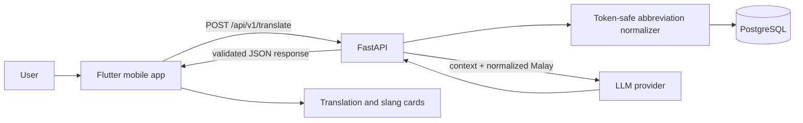

# LokalTranslator architecture



## Translation request lifecycle

1. Flutter validates non-empty input and sends text, target language, and tone.
2. FastAPI validates request length and enum values.
3. The normalizer loads abbreviation mappings and replaces complete tokens only.
4. The backend retrieves slang context records that occur in the normalized text.
5. If configured, the LLM receives target language, tone, text, and slang context and must return JSON.
6. FastAPI returns a stable response object; Flutter renders translation and slang details.

## Response contract

```json
{
  "original_text": "xleh dtg skrg",
  "normalized_text": "tidak boleh datang sekarang",
  "translated_text": "...",
  "target_language": "English",
  "tone": "casual",
  "slang_breakdown": [],
  "provider": "llm"
}
```
